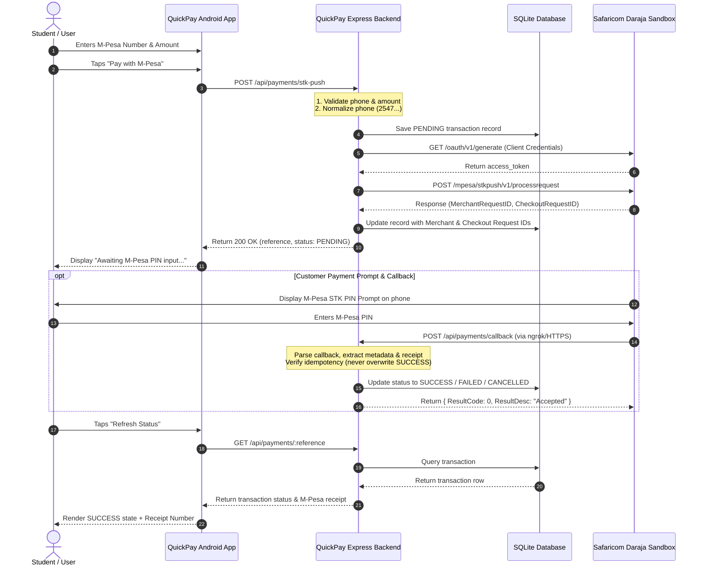

# QuickPay Architecture Documentation

## 1. Executive Overview

QuickPay is an Android mobile payment application built for academic demonstration, integrated with Safaricom's Daraja Lipa Na M-Pesa Express (STK Push) API via a Node.js Express backend and an SQLite database.

The application follows clean separation of concerns:
- **Android App Layer**: Modern Android Views, ViewBinding, ViewModel, Retrofit, Coroutines, Material Design.
- **Backend Service Layer**: Express.js REST API, Request Validation, Error Handling, Phone Normalization, Daraja OAuth & STK Push Integration, SQLite Persistence, Idempotent Callback Processing.
- **External Payment Gateway**: Safaricom Daraja Sandbox API.

---

## 2. High-Level Architecture Diagram

---

## 3. Core Component Description

### A. Android Client (`/app`)
- **`MainActivity` & `MainViewModel`**: Payment form screen. Validates input, normalizes phone numbers, calls backend `POST /api/payments/stk-push`, handles loading & error states.
- **`PaymentStatusActivity` & `PaymentStatusViewModel`**: Transaction status screen. Polls or refreshes status from `GET /api/payments/:reference`, displays status badges (SUCCESS, PENDING, FAILED, CANCELLED), M-Pesa receipt number, and user-friendly explanation.
- **`TransactionHistoryActivity` & `TransactionHistoryViewModel`**: Transaction history screen. Displays bounded list of past payments in a `RecyclerView` using `TransactionAdapter`.
- **`PaymentRepository` & `QuickPayApiService`**: Data repository layer wrapping Retrofit network calls with Kotlin `Result<T>` handling.

### B. Express Backend (`/server`)
- **`app.js` & `index.js`**: Express server initialization, health check, CORS, JSON parsing, database migrations startup.
- **`requestValidation.js`**: Input sanitization and phone normalization middleware.
- **`phone.js`**: Kenyan M-Pesa phone normalization utility (`normalizePhoneNumber`) and masking utility (`maskPhoneNumber`).
- **`darajaService.js`**: Communicates with Safaricom Daraja Sandbox API. Handles OAuth token caching, timestamping, Base64 password generation, and STK Push requests.
- **`paymentService.js`**: Encapsulates database transactions, callback parsing, status updates, and idempotency checks.
- **`db.js` & `migrations.js`**: SQLite connection wrapper (`better-sqlite3`) with WAL journal mode and auto-migrations.

---

## 4. Key Security & Design Principles

1. **Zero Client Secrets**: No Consumer Key, Consumer Secret, Passkey, or Authorization headers exist inside the Android application binary.
2. **Pre-Save Persistence**: Transactions are saved as `PENDING` in SQLite *before* calling Daraja, ensuring auditability even if network drops.
3. **Strict Idempotency**: Duplicate or out-of-order callbacks cannot overwrite an already confirmed `SUCCESS` transaction.
4. **Phone Masking**: Phone numbers are masked in public API responses (`2547****5678`) to protect personal privacy.
5. **No PIN Storage**: QuickPay never asks for or stores the user's M-Pesa PIN. The PIN is entered strictly in the system-provided Safaricom prompt.
