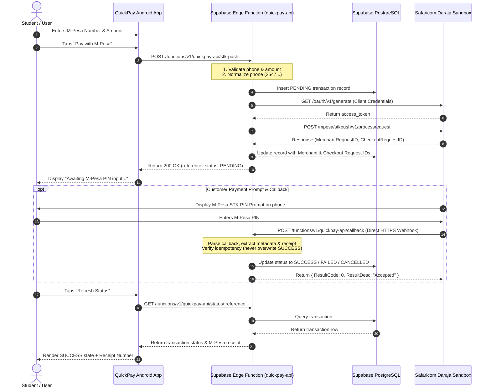

# QuickPay Architecture Documentation (Supabase Cloud Migration)

## 1. Executive Overview

QuickPay is an Android mobile payment application built for academic demonstration, integrated with Safaricom's Daraja Lipa Na M-Pesa Express (STK Push) API via **Supabase Edge Functions** (TypeScript / Deno) and a cloud-hosted **Supabase PostgreSQL** database.

The application follows clean separation of concerns:
- **Android App Layer**: Modern Android Views, ViewBinding, ViewModel, Retrofit, Coroutines, Material Design. Connected directly to Supabase Edge Function endpoints.
- **Supabase Cloud Backend**: Deno TypeScript Edge Function (`quickpay-api`), Request Validation, Error Handling, Phone Normalization, Daraja OAuth & STK Push Integration, PostgreSQL Persistence, Idempotent Callback Processing.
- **External Payment Gateway**: Safaricom Daraja Sandbox API.

---

## 2. High-Level Architecture Diagram

---

## 3. Core Component Description

### A. Android Client (`/app`)
- **`MainActivity` & `MainViewModel`**: Payment form screen. Validates input, normalizes phone numbers, calls Supabase Edge Function `POST /stk-push`, handles loading & error states.
- **`PaymentStatusActivity` & `PaymentStatusViewModel`**: Transaction status screen. Polls or refreshes status from `GET /status/:reference`, displays status badges (`SUCCESS`, `PENDING`, `FAILED`, `CANCELLED`), M-Pesa receipt number, and user-friendly explanation.
- **`TransactionHistoryActivity` & `TransactionHistoryViewModel`**: Transaction history screen. Displays bounded list of past payments in a `RecyclerView` using `TransactionAdapter`.
- **`PaymentRepository` & `QuickPayApiService`**: Data repository layer wrapping Retrofit network calls to Supabase with Kotlin `Result<T>` handling.

### B. Supabase Cloud Backend (`/supabase`)
- **`supabase/functions/quickpay-api/index.ts`**: Main Deno TypeScript entry point serving health checks, STK Push initiation, webhook callbacks, status queries, and history endpoints.
- **`supabase/functions/_shared/daraja.ts`**: Communicates with Safaricom Daraja Sandbox API. Handles OAuth token caching, timestamping, Base64 password generation, and STK Push requests.
- **`supabase/functions/_shared/paymentService.ts`**: Encapsulates database transactions, callback parsing, status updates, and idempotency checks.
- **`supabase/functions/_shared/phone.ts`**: Phone normalization (`normalizePhoneNumber`) and masking (`maskPhoneNumber`).
- **`supabase/functions/_shared/supabaseClient.ts`**: Creates authenticated Supabase client for PostgreSQL operations.
- **`supabase/migrations/20260330000000_create_payments_table.sql`**: PostgreSQL migration creating `payments` table, indexes, `updated_at` trigger, and RLS policies.

---

## 4. Key Security & Design Principles

1. **Zero Client Secrets**: No Consumer Key, Consumer Secret, Passkey, or Authorization headers exist inside the Android application binary.
2. **No ngrok Required**: Deployed on Supabase Edge Functions with a public HTTPS URL (`https://injsofnemhbedeswjyev.supabase.co/functions/v1/quickpay-api`), eliminating the need for local tunnels.
3. **Pre-Save Persistence**: Transactions are saved as `PENDING` in PostgreSQL *before* calling Daraja, ensuring auditability even if network drops.
4. **Strict Idempotency**: Duplicate or out-of-order callbacks cannot overwrite an already confirmed `SUCCESS` transaction.
5. **Phone Masking**: Phone numbers are masked in public API responses (`2547****5678`) to protect personal privacy.
6. **No PIN Storage**: QuickPay never asks for or stores the user's M-Pesa PIN. The PIN is entered strictly in the system-provided Safaricom prompt.
